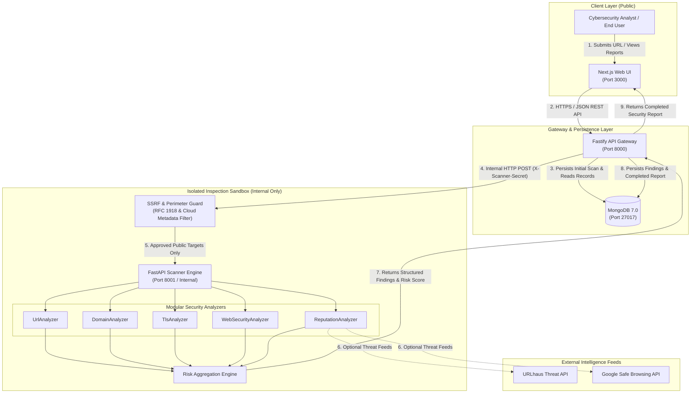

# SENTRIX System Architecture

> **Tagline:** Don't trust the link. Verify the threat.

SENTRIX is a modular, high-throughput website threat detection and trust intelligence platform engineered to identify credential phishing, domain impersonation, malicious redirects, TLS/SSL weaknesses, and web security misconfigurations.

---

## 1. Project Overview

### 1.1 Purpose
The modern web attack surface is dominated by rapid-cycle phishing infrastructure, typosquatting, dynamic credential harvesting portals, and insecure TLS configurations. SENTRIX provides automated, multi-layered link verification that evaluates URLs in a hardened sandbox before users interact with them.

### 1.2 Core Capabilities
- **Heuristic Phishing & Impersonation Detection:** Lexical analysis, homoglyph/punycode (`xn--`) detection, excessive subdomain stacking, and brand typosquatting.
- **Cryptographic & TLS Auditing:** Direct SSL/TLS handshakes, certificate chain inspection, validity checks, SHA-256 fingerprinting, and hostname match validation.
- **Web Security Misconfiguration Assessment:** HTTP response header checks (`HSTS`, `CSP`, `X-Frame-Options`, `nosniff`), form target auditing, and hidden iframe discovery.
- **SSRF Perimeter Defense:** Pre-flight DNS resolution and IP address validation rejecting RFC 1918 private subnets, loopback interfaces, and cloud instance metadata.
- **Crowdsourced Threat Consensus:** Community-reported threat feed with voting mechanisms.
- **Explainable Threat Scoring:** Multi-vector weighted score (0–100) mapping to `BENIGN`, `SUSPICIOUS`, or `MALICIOUS` with associated MITRE ATT&CK tactics.

### 1.3 Technology Stack
- **Frontend:** Next.js 14 (App Router), TypeScript, Tailwind CSS, Lucide Icons, Recharts.
- **Backend API:** Node.js, Fastify 5, TypeScript, Mongoose ODM, `@fastify/rate-limit`, `@fastify/cors`.
- **Security Scanner:** Python 3.15, FastAPI, Pydantic v2, `httpx`, `BeautifulSoup4`, `cryptography`, `tldextract`.
- **Database:** MongoDB 7.0 with compound and unique indexes.
- **Infrastructure:** Docker, Docker Compose, rootless Podman compatibility, single root `.env`.

---

## 2. High-Level System Architecture

SENTRIX is structured into four decoupled layers:

1. **Client Layer (`apps/web`):** Next.js App Router presentation layer. Zero database access, communicates solely with the Fastify API via `NEXT_PUBLIC_API_URL`.
2. **Gateway & Persistence Layer (`apps/api`):** Fastify backend server. Holds sole responsibility for MongoDB connection, request validation, business rules, rate limiting, and scan orchestration.
3. **Sandbox Inspection Tier (`services/scanner`):** Stateless Python FastAPI service. Strictly isolated on internal networking (no host port exposure, no database credentials), guarded by pre-shared key authentication.
4. **Data Layer (`mongodb`):** MongoDB 7.0 document store managing polymorphic security findings, certificates, scans, and community reports.
5. **External Threat Intelligence:** Integrations for URLhaus malware repositories and Google Safe Browsing Lookup API.

---

## 3. System Design Diagram



---

## 4. Core Scan Workflow

### Scan Lifecycle Sequence

1. **Submission:** User enters target URL in Next.js frontend (`/scanner` or `/`).
2. **Client Validation:** Frontend validates syntax using Zod and sends `POST /api/v1/scans`.
3. **Normalization:** Fastify normalizes the URL (enforces scheme, standardizes host, strips default ports).
4. **Initialization:** Fastify creates a `Scan` document in MongoDB with status `IN_PROGRESS`.
5. **Delegation:** Fastify transmits analysis payload to Python scanner with `X-Scanner-Secret`.
6. **Perimeter Verification:** Scanner resolves DNS and verifies that all IPs do not belong to loopback, private RFC 1918, or cloud metadata networks.
7. **Analyzer Execution:**
   - `UrlAnalyzer` evaluates lexical structure, length, homoglyphs, and auth keywords.
   - `DomainAnalyzer` extracts taxonomy and evaluates brand impersonation.
   - `TlsAnalyzer` establishes direct TLS handshake, extracts cert chain, checks expiration and host matching.
   - `WebSecurityAnalyzer` checks defensive headers and inspects DOM forms for credential theft.
   - `ReputationAnalyzer` checks open blacklist repositories.
8. **Risk Calculation:** `RiskAggregationEngine` computes weighted score (0–100) and assigns verdict (`BENIGN`, `SUSPICIOUS`, `MALICIOUS`).
9. **Result Ingestion:** Scanner responds to Fastify with `AnalysisResponse`.
10. **Persistence:** Fastify bulk-inserts `Finding` documents, upserts `Certificate`, and marks `Scan` as `COMPLETED`.
11. **Presentation:** Frontend receives scan metadata, queries `/api/v1/reports/:id`, and renders forensic visualizer.

```mermaid
sequenceDiagram
    autonumber
    actor User as User / Analyst
    participant Web as Next.js Web UI
    participant API as Fastify API
    participant DB as MongoDB
    participant Scanner as Python Scanner Engine

    User->>Web: Enter URL (e.g., https://paypal-security.xyz/login)
    Web->>API: POST /api/v1/scans { url, deepScan }
    API->>API: Normalize URL & validate syntax (Zod)
    API->>DB: Insert Scan record (status: IN_PROGRESS)
    API->>Scanner: POST /api/v1/analyze (Header: X-Scanner-Secret)

    rect rgb(20, 25, 45)
        Note over Scanner: Perimeter Defense Check
        Scanner->>Scanner: validate_url_safety(): Check DNS, loopback & private subnets
        alt Target violates SSRF policy
            Scanner-->>API: 400 Bad Request (SSRF_VIOLATION)
            API->>DB: Update Scan (status: FAILED, error: SSRF_VIOLATION)
            API-->>Web: 400 Bad Request with forensic warning
        end
        Note over Scanner: Multi-Vector Analyzer Pipeline
        Scanner->>Scanner: Run Url, Domain, Tls, WebSecurity & Reputation Analyzers
        Scanner->>Scanner: RiskAggregationEngine.evaluate()
    end

    Scanner-->>API: 200 OK (AnalysisResponse)
    API->>DB: Bulk insert Findings
    API->>DB: Upsert Certificate record
    API->>DB: Update Scan (status: COMPLETED, riskScore, verdict, completedAt)
    API-->>Web: 201 Created (Scan metadata)
    Web->>API: GET /api/v1/reports/:id
    API->>DB: Fetch Scan, Findings, and Certificate
    DB-->>API: Document records
    API-->>Web: 200 OK (Full Forensic Security Report)
    Web-->>User: Render Risk Score Gauge, Findings Tree & TLS Card
```



---

## 5. Module Responsibilities

| Service | Module | Responsibility | Key Files |
| :--- | :--- | :--- | :--- |
| **Fastify API** | `modules/scans` | Request validation, URL normalization, scan dispatch, and scan status querying. | `apps/api/src/modules/scans/` |
| **Fastify API** | `modules/reports` | Aggregates scan, findings, certificate, and summary for full report views. | `apps/api/src/modules/reports/` |
| **Fastify API** | `modules/threats` | Global threat index querying across verified malicious and suspicious scans. | `apps/api/src/modules/threats/` |
| **Fastify API** | `modules/community` | Crowdsourced threat submissions, deduplication via SHA-256 hash, and peer voting. | `apps/api/src/modules/community/` |
| **Fastify API** | `modules/dashboard` | Real-time telemetry statistics computed directly from MongoDB. | `apps/api/src/modules/dashboard/` |
| **Scanner** | `safety` | Pre-flight SSRF guard, IP subnet validation, and cloud metadata blocking. | `services/scanner/app/safety/` |
| **Scanner** | `analyzers` | Modular analyzers: URL lexical, domain impersonation, TLS certificate, web security, reputation. | `services/scanner/app/analyzers/` |
| **Scanner** | `scoring` | Weighted heuristic scoring engine mapping findings to verdicts and MITRE tactics. | `services/scanner/app/scoring/` |
| **Shared** | `packages/shared` | Centralized TypeScript types, Zod schemas, micro-contracts, and URL utilities. | `packages/shared/src/` |

---

## 6. Database Design

MongoDB 7.0 is the sole application database. Mongoose models are strictly housed in `apps/api/src/models/`.

### Collections & Indexes

1. **`scans`**:
   - Fields: `submittedUrl`, `normalizedDomain`, `status`, `riskScore`, `verdict`, `confidence`, `analyzerStatuses`, `summary`, `errorMessage`, `completedAt`, timestamps.
   - Indexes: `{ normalizedDomain: 1, createdAt: -1 }`, `{ status: 1 }`, `{ verdict: 1 }`, `{ createdAt: -1 }`.
2. **`findings`**:
   - Fields: `scanId`, `category`, `severity`, `title`, `description`, `evidence` (Mixed), `confidence`, timestamps.
   - Indexes: `{ scanId: 1, severity: 1 }`, `{ category: 1 }`.
3. **`certificates`**:
   - Fields: `scanId` (unique), `issuer`, `subject`, `validFrom`, `validUntil`, `fingerprint`, `hostnameMatched`, `rawDetails`.
   - Indexes: `{ scanId: 1 }` (unique), `{ fingerprint: 1 }`.
4. **`threatreports`**:
   - Fields: `submittedUrl`, `normalizedDomain`, `urlHash` (SHA-256), `category`, `description`, `status`, `reportCount`, `submitterEmail`, timestamps.
   - Indexes: `{ urlHash: 1 }`, `{ normalizedDomain: 1 }`, `{ status: 1 }`, `{ createdAt: -1 }`.
5. **`threatvotes`**:
   - Fields: `reportId`, `userId`, `vote` (`UPVOTE` | `DOWNVOTE`), timestamps.
   - Indexes: `{ reportId: 1, userId: 1 }` (unique compound index to enforce single vote per user/session).
6. **`users`**:
   - Fields: `email` (unique), `passwordHash`, `role` (`user` | `analyst` | `admin`), timestamps.
   - Indexes: `{ email: 1 }` (unique).

---

## 7. API Architecture

### Public API (Owned by Fastify Gateway on Port 8000)

| Endpoint | Method | Responsibility |
| :--- | :--- | :--- |
| `/health` | `GET` | Health status and MongoDB connection state. |
| `/api/v1/scans` | `POST` | Submits URL, dispatches to scanner, saves results, returns initial scan verdict. |
| `/api/v1/scans` | `GET` | Lists recent scans with pagination and domain filtering. |
| `/api/v1/scans/:id` | `GET` | Retrieves scan status and metadata. |
| `/api/v1/reports/:id` | `GET` | Retrieves comprehensive report: scan, findings, certificate, and summary. |
| `/api/v1/threats` | `GET` | Retrieves verified malicious/suspicious domains and community alerts. |
| `/api/v1/community/reports` | `POST` | Submits a community threat report. |
| `/api/v1/community/reports` | `GET` | Lists community reports with computed upvote/downvote totals. |
| `/api/v1/community/reports/:id/vote` | `POST` | Casts an upvote or downvote on a community report. |
| `/api/v1/dashboard/stats` | `GET` | Real-time platform metrics (scans count, verdicts count, average risk). |

### Internal API (Owned by Python Scanner on Port 8001 / Internal Only)

| Endpoint | Method | Responsibility | Auth |
| :--- | :--- | :--- | :--- |
| `/health` | `GET` | Internal scanner status and loaded analyzers list. | None |
| `/api/v1/analyze` | `POST` | Executes SSRF guard, analyzers, scoring engine, returns `AnalysisResponse`. | `X-Scanner-Secret` header |

---

## 8. Security Architecture

1. **SSRF Perimeter Defense & Safe DNS Resolution:**
   - Pre-flight DNS resolution validates destination hostnames via `socket.getaddrinfo`, inspecting all returned A and AAAA records against blacklisted CIDRs (Loopback `127.0.0.0/8`, `::1/128`, RFC 1918 `10.0.0.0/8`, `172.16.0.0/12`, `192.168.0.0/16`, Link-Local & Cloud Metadata `169.254.0.0/16`, `fe80::/10`, Unique Local `fc00::/7`, IPv4-mapped IPv6 `::ffff:...`, and carrier-grade NAT).
   - Rejects non-http(s) schemes, non-standard ports, and embedded user credentials (`user:pass@`). Fails closed on DNS errors.
2. **Socket-Level Connection-Time IP Pinning (Anti-TOCTOU Rebinding):**
   - Implements `PinnedIPNetworkBackend` on top of `httpcore.AnyIOBackend` to intercept `connect_tcp`.
   - Forces the underlying socket connection directly to the pre-validated IP address while propagating `server_hostname` to `start_tls`, eliminating Time-Of-Check to Time-Of-Use DNS rebinding while fully preserving TLS SNI and certificate validation.
3. **Controlled Redirect Validation Loop:**
   - Automatic HTTP client redirect following is disabled (`follow_redirects=False`).
   - The scanner executes an explicit redirect loop (max 5 hops) with loop detection via `seen_urls`. Every redirect destination is validated against SSRF rules before initiating the subsequent TCP connection.
4. **Strict TLS Cryptographic Integrity:**
   - Mandatory certificate verification (`verify=True`, `CERT_REQUIRED`, `check_hostname=True`) on all web requests.
   - Broken certificates, expired certs, and hostname mismatches are forensically inspected and classified with CRITICAL/HIGH findings without insecure fallback bypasses.
5. **Bounded Streaming HTTP Body Reads:**
   - Streaming consumption reads response bytes via `stream_resp.aiter_bytes(chunk_size=16384)` with a strict 1 MB (1,048,576 byte) ceiling.
   - Reading terminates immediately upon reaching the limit, sets `isTruncated = True`, and generates a forensic finding to prevent memory exhaustion and decompression bombs. DOM parsing is restricted strictly to verified HTML content types.
6. **Fastify API Hardening & Information Leakage Prevention:**
   - Input sanitization: `escapeRegex()` escapes all special characters in domain and threat search parameters; `sanitizePagination()` clamps pagination bounds (`skip >= 0`, `limit <= 100`).
   - Central error handling: Redacts internal 500 error messages, hiding database strings, credentials, and stack traces from client responses while logging correlation IDs internally.
   - Proxy security: Configures restricted `trustProxy` CIDRs to prevent spoofing of IP headers for rate-limiting.
7. **Constant-Time Secret Authentication:**
   - Python scanner enforces `X-Scanner-Secret` pre-shared key validation using `secrets.compare_digest` to prevent timing side-channel attacks.
8. **Docker Container Environment Scoping (Least Privilege):**
   - In `docker-compose.yml`, blanket `env_file` loading is eliminated for `scanner` and `web`. Explicit variable mapping ensures database credentials (`MONGODB_URI`) are passed solely to the Fastify API container and are completely inaccessible inside the Python scanner or Next.js container.
9. **Zero-Trust Threat Intelligence Failure Propagation:**
   - External threat feed queries distinguish four structured outcomes: `MATCH`, `NO_MATCH`, `ERROR`, and `SKIPPED`. Network drops, rate limits, and provider timeouts are captured as `ERROR` and recorded as `FAILED`/`PARTIAL`, never allowing upstream outages to mask as clean verdicts.
10. **Community Voting Anti-Abuse Controls:**
    - Replaces client-controlled session IDs with deterministic, server-derived voter identities (`sha256(voter:${request.ip})`) enforced by MongoDB's unique compound index `{ reportId: 1, userId: 1 }`.
    - Applies dedicated route-level rate limiting (20 votes per minute per IP) with 429 response enforcement to prevent voting manipulation.

---

## 9. Risk Scoring Architecture

### Heuristic Scoring Formula
- Base risk score = `0`
- Weighted severity contributions:
  - `CRITICAL`: +40 (e.g., brand impersonation, credential form posting externally, active blacklist match, expired TLS)
  - `HIGH`: +25 (e.g., direct IP in URL, self-signed certificate, hostname mismatch, insecure form over HTTP)
  - `MEDIUM`: +12 (e.g., punycode homoglyph, excessive subdomain depth, multiple redirect hops)
  - `LOW`: +5 (e.g., missing HSTS, missing CSP, missing nosniff header, body truncation)
  - `INFO`: +0 (informational taxonomy findings)
- Risk score is clamped between `0` and `100`.

### Verdict Classification & Zero-Trust Inconclusive State
- `0 – 25`: **`BENIGN`** (Trusted destination, valid TLS, complete inspection, zero high-severity indicators)
- `26 – 69`: **`SUSPICIOUS`** (Elevated risk, multiple anomalies, or missing cryptographic trust)
- `70 – 100`: **`MALICIOUS`** (High confidence phishing, credential harvesting, or verified malware)
- **`INCONCLUSIVE`**: Assigned when analyzers fail, time out, or target is unreachable, and risk score is < 26.

> [!IMPORTANT]
> **Zero-Trust Invariant:** Missing or failed analyzer results are NEVER treated as proof that a website is safe. When an analyzer fails or a site is unreachable, the system assigns `analysisStatus = "PARTIAL"` or `"FAILED"`, marks `verdict = "INCONCLUSIVE"`, penalizes confidence ratings, and records explicit `inconclusiveReasons`. The frontend displays a dedicated warning banner to alert analysts to incomplete inspection data.

---

## 10. Development & Deployment Workflow

### 10.1 Single Root `.env` Strategy
A single `.env` file at repository root centralizes all service configuration:
- Next.js loads root `.env` via `next.config.js` with `dotenv` (exposing only `NEXT_PUBLIC_` variables to client bundles).
- Fastify loads root `.env` via `apps/api/src/config/index.ts` and validates schema on boot with Zod.
- Python FastAPI loads root `.env` via `services/scanner/app/config/settings.py` with `pydantic-settings`.
- Docker Compose reads host environment variables from root `.env` and uses explicit service-level variable mapping (`environment:`) to enforce least privilege (e.g. database credentials passed strictly to Fastify, isolated from scanner and web).

### 10.2 Multi-Service Startup
```bash
# 1. Start MongoDB
docker run -d --name sentrix-mongo -p 27017:27017 mongo:7.0

# 2. Run services using npm
npm run dev:scanner   # Starts Python scanner on :8001
npm run dev:api       # Starts Fastify API on :8000
npm run dev:web       # Starts Next.js on :3000
```

---

## 11. Architectural Principles

1. **Separation of Concerns:** Presentation (`web`), business logic & persistence (`api`), and active untrusted execution (`scanner`) reside in isolated services.
2. **Single Responsibility:** Each module, schema, and analyzer owns exactly one operational domain.
3. **Zero-Trust Input Sanitization:** Every URL is treated as hostile. SSRF guards run prior to any network socket creation.
4. **Stateless Scanner Isolation:** The scanner has zero persistent state and zero database credentials. If a scanner instance is compromised, database integrity remains unaffected.
5. **High Cohesion & Low Coupling:** Shared models reside in `@sentrix/shared`. Services communicate exclusively over validated JSON HTTP contracts.
6. **Maintainability over Abstraction:** Clear, idiomatic TypeScript and Python without unnecessary layers, mock abstractions, or artificial microservices.
