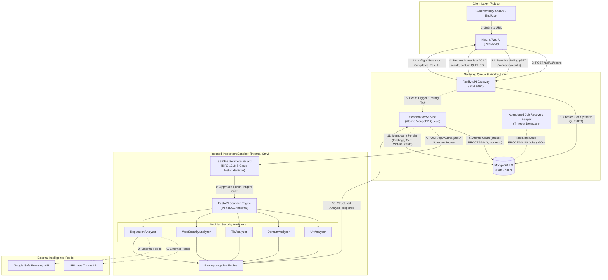
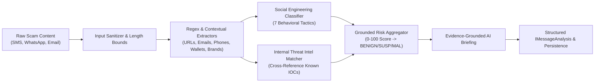
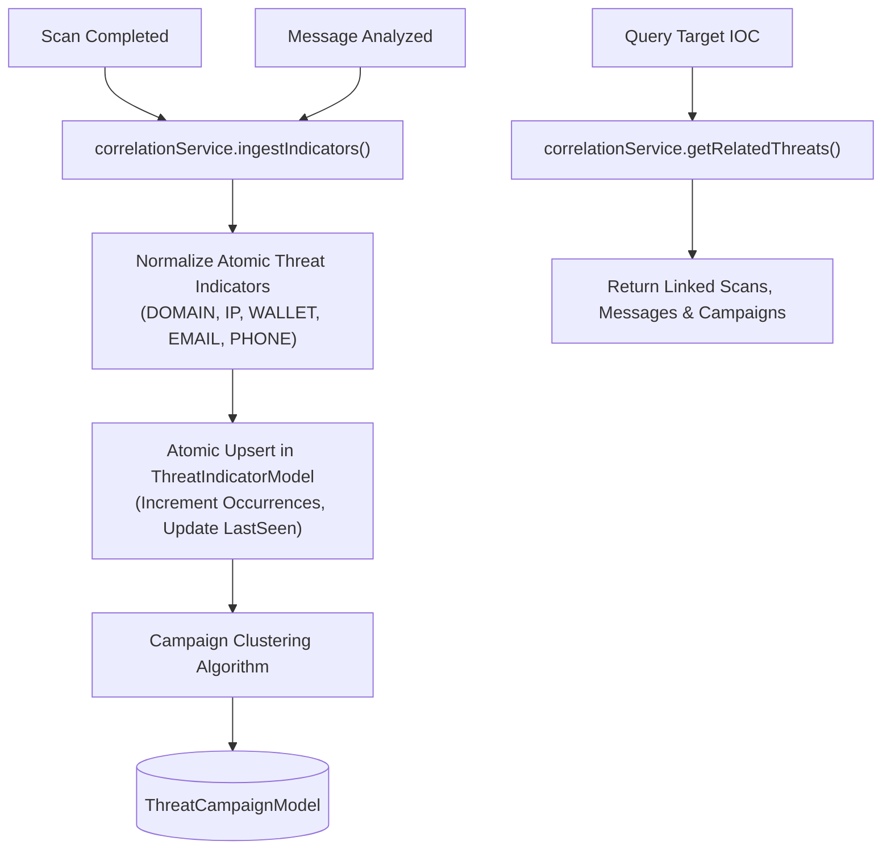
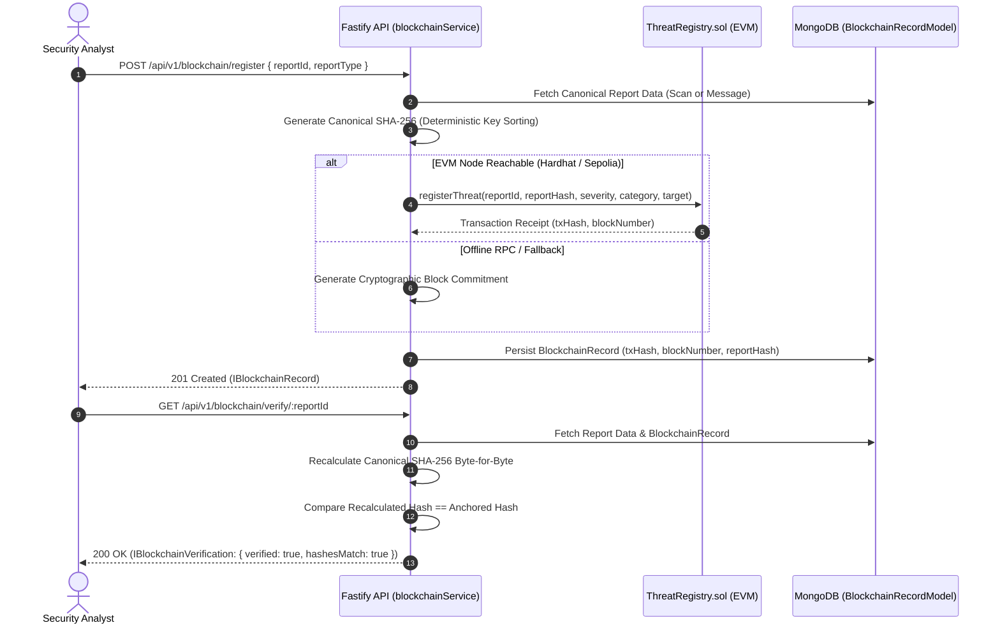

# SENTRIX System Architecture

> **Tagline:** Don't trust the link. Verify the threat.

SENTRIX is a modular, high-throughput website threat detection and trust intelligence platform engineered to identify credential phishing, domain impersonation, malicious redirects, TLS/SSL weaknesses, and web security misconfigurations.

---

## 1. Project Overview

### 1.1 Purpose
The modern web attack surface is dominated by rapid-cycle phishing infrastructure, typosquatting, dynamic credential harvesting portals, multi-channel social engineering (SMS, WhatsApp, phishing emails), and insecure TLS configurations. SENTRIX provides automated, multi-layered threat verification that evaluates URLs and deceptive messages in a hardened sandbox before users interact with them, correlates threat indicators across attack campaigns, anchors cryptographic commitments on EVM smart contracts, and generates evidence-grounded AI explanations.

### 1.2 Core Capabilities
- **Heuristic Phishing & Impersonation Detection:** Lexical analysis, homoglyph/punycode (`xn--`) detection, excessive subdomain stacking, and brand typosquatting.
- **AI-Powered Scam & Message Analysis (Module A):** Deep multi-channel inspection (SMS, WhatsApp, Email, Telegram, Social Media) extracting IOCs (URLs, emails, phones, crypto wallets, payment references, impersonated entities) and detecting 7 social engineering manipulation tactics.
- **Intelligent Threat Correlation & Campaign Clustering (Module B):** Automated IOC linkage (shared domains, IPs, wallets, emails, phone numbers) across independent scans and scam messages into attributed campaigns.
- **Web3 Decentralized Threat Registry (Module C):** Solidity 0.8.20 smart contract (`ThreatRegistry.sol`) anchoring immutable, canonical SHA-256 threat commitments to EVM blockchains with independent byte-for-byte verification.
- **Grounded AI Explanation & Threat Briefing (Module D):** Zero-hallucination cybersecurity briefing strictly grounded in observed evidence with deterministic fallback engine.
- **Cryptographic & TLS Auditing:** Direct SSL/TLS handshakes, certificate chain inspection, validity checks, SHA-256 fingerprinting, and hostname match validation.
- **Web Security Misconfiguration Assessment:** HTTP response header checks (`HSTS`, `CSP`, `X-Frame-Options`, `nosniff`), form target auditing, and hidden iframe discovery.
- **SSRF Perimeter Defense:** Pre-flight DNS resolution and IP address validation rejecting RFC 1918 private subnets, loopback interfaces, and cloud instance metadata.
- **Crowdsourced Threat Consensus:** Community-reported threat feed with voting mechanisms.
- **Explainable Threat Scoring:** Multi-vector weighted score (0–100) mapping to `BENIGN`, `SUSPICIOUS`, or `MALICIOUS` with associated MITRE ATT&CK tactics.

### 1.3 Technology Stack
- **Frontend:** Next.js 14 (App Router), TypeScript, Tailwind CSS, Lucide Icons, Recharts.
- **Backend API:** Node.js, Fastify 5, TypeScript, Mongoose ODM, `@fastify/rate-limit`, `@fastify/cors`.
- **Security Scanner:** Python 3.15, FastAPI, Pydantic v2, `httpx`, `BeautifulSoup4`, `cryptography`, `tldextract`.
- **Database:** MongoDB 7.0 with compound and unique indexes.
- **Infrastructure:** Docker, Docker Compose, rootless Podman compatibility, single root `.env`.

---

## 2. High-Level System Architecture

SENTRIX is structured into four decoupled layers:

1. **Client Layer (`apps/web`):** Next.js App Router presentation layer. Zero database access, communicates solely with the Fastify API via `NEXT_PUBLIC_API_URL`.
2. **Gateway & Persistence Layer (`apps/api`):** Fastify backend server. Holds sole responsibility for MongoDB connection, request validation, business rules, rate limiting, and scan orchestration.
3. **Sandbox Inspection Tier (`services/scanner`):** Stateless Python FastAPI service. Strictly isolated on internal networking (no host port exposure, no database credentials), guarded by pre-shared key authentication.
4. **Data Layer (`mongodb`):** MongoDB 7.0 document store managing polymorphic security findings, certificates, scans, and community reports.
5. **External Threat Intelligence:** Integrations for URLhaus malware repositories and Google Safe Browsing Lookup API.

---

## 3. System Design Diagram

### Asynchronous System Flow

```
Scan Request -> MongoDB Queue -> Worker Claims Job -> Unique Lease Token -> Python Scanner -> Attempt-Scoped Result Persistence -> Lease Ownership Validation -> Atomic Result Publication -> Scan COMPLETED
```



---

## 4. Core Scan Workflow

### Asynchronous Scan Lifecycle Sequence

1. **Submission:** User enters target URL in Next.js frontend (`/scanner` or `/`).
2. **Client Validation:** Frontend validates syntax using Zod and sends `POST /api/v1/scans`.
3. **Normalization & Deduplication:**
   - Fastify normalizes the URL (enforces scheme, standardizes host, strips default ports) and computes SHA-256 `urlHash`.
   - Checks MongoDB for active duplicate scans (`status IN [QUEUED, PROCESSING]`).
   - Enforced by database-level partial unique index `{ urlHash: 1 }` with `{ status: { $in: ['QUEUED', 'PROCESSING'] } }`. If concurrent requests race, the second request catches MongoDB E11000 duplicate key error and safely returns the winning active scan with `isDuplicate: true`.
4. **Queue Initialization:** Fastify inserts a `Scan` document in MongoDB with `status = "QUEUED"`, `retryCount = 0`, and immediately returns HTTP 201 `{ scanId, status: "QUEUED" }` to client without awaiting scanner completion.
5. **Immediate Worker Signal:** Fastify fires `scanWorker.trigger()` to wake up the background worker event loop.
6. **Atomic Job Claiming & Cryptographic Lease Fencing:**
   - Background worker executes an atomic MongoDB `findOneAndUpdate` issuing a unique `leaseToken = crypto.randomUUID()`:
     ```typescript
     ScanModel.findOneAndUpdate(
       { status: 'QUEUED', retryCount: { $lt: 3 } },
       { $set: { status: 'PROCESSING', workerId: this.workerId, claimedAt: new Date(), leaseToken } },
       { sort: { createdAt: 1 }, new: true }
     );
     ```
   - Bounded concurrency: at most 3 simultaneous active jobs per worker process.
   - **Lease Fencing:** Before any persistent state mutation (findings insertion, status update, or error handling), the worker enforces lease ownership: `{ _id: scan._id, leaseToken: scan.leaseToken, status: ScanStatusEnum.PROCESSING }`. If a worker's lease expired or was revoked by the reaper, its update fails, inserted findings are rolled back, and it cannot corrupt a newly claimed worker's state.
7. **Perimeter Verification:** Scanner resolves DNS and verifies that all IPs do not belong to loopback, private RFC 1918, or cloud metadata networks.
8. **Analyzer Execution:**
   - `UrlAnalyzer` evaluates lexical structure, length, homoglyphs, and auth keywords.
   - `DomainAnalyzer` extracts taxonomy and evaluates brand impersonation.
   - `TlsAnalyzer` establishes direct TLS handshake, extracts cert chain, checks expiration and host matching.
   - `WebSecurityAnalyzer` checks defensive headers and inspects DOM forms for credential theft.
   - `ReputationAnalyzer` checks open blacklist repositories.
9. **Risk Calculation:** `RiskAggregationEngine` computes weighted score (0–100) and assigns verdict (`BENIGN`, `SUSPICIOUS`, `MALICIOUS`, or `INCONCLUSIVE`).
10. **Attempt-Scoped Result Persistence & Atomic Result Publication:**
    - Worker enforces lease ownership before persisting: `{ _id: scan._id, leaseToken: scan.leaseToken, status: 'PROCESSING' }`.
    - Pre-write attempt cleanup: deletes any prior findings or certificates created under *this specific attempt*: `{ scanId: scan._id, leaseToken: scan.leaseToken }`. Stale workers can never delete artifacts belonging to other workers.
    - Persists fresh `Finding` and `Certificate` documents tagged with `leaseToken = scan.leaseToken`.
    - Atomically publishes results using fenced condition:
      ```typescript
      ScanModel.findOneAndUpdate(
        { _id: scan._id, leaseToken: scan.leaseToken, status: ScanStatusEnum.PROCESSING },
        { $set: { status: ScanStatusEnum.COMPLETED, publishedLeaseToken: scan.leaseToken, ... } }
      );
      ```
    - Fenced rollback: if atomic update returns null (lease was lost or reclaimed), the worker rolls back only its own attempt artifacts (`{ scanId: scan._id, leaseToken: scan.leaseToken }`) and aborts cleanly.
    - Post-publication cleanup: upon successful completion, safely prunes older superseded attempts (`{ scanId: scan._id, leaseToken: { $ne: scan.leaseToken } }`). Reader endpoints query strictly by `leaseToken: scan.publishedLeaseToken` when `status === COMPLETED`.
11. **Error & Retry Handling:**
    - Permanent security violations (HTTP 400 / SSRF) immediately mark scan `status = "FAILED"` with 0 retries.
    - Transient scanner network errors increment `retryCount` and re-queue (`status = "QUEUED"`) up to `MAX_RETRIES = 3`.
    - Wrapped in database outage guards to prevent unhandled promise rejections if MongoDB disconnects.
12. **Conditional Atomic Reaper:**
    - Background interval (every 15s) inspects scans stuck in `status = "PROCESSING"` longer than 60s timeout ceiling.
    - Reclaims jobs atomically via `findOneAndUpdate({ _id, leaseToken, status: 'PROCESSING', claimedAt })`, preventing races with workers that completed right as the reaper ran.
    - If `retryCount < MAX_RETRIES`, re-queues to `QUEUED`; if exceeded, marks `FAILED`.
13. **Orphan-Artifact Recovery & Cleanup (`OrphanCleanupService`):**
    - Periodic background maintenance (every 5 minutes) and on-demand sweep evaluates candidate attempt artifacts older than the retention threshold (`retentionMs = 10 minutes`, guaranteeing 60s worker leases have expired).
    - Attempts are evaluated strictly by `(scanId, leaseToken)`:
      - **Published artifacts** (`scan.status === COMPLETED && scan.publishedLeaseToken === leaseToken`) are **strictly preserved**.
      - **Active worker artifacts** (`scan.status === PROCESSING && scan.leaseToken === leaseToken`) are **strictly preserved**.
      - **Untagged legacy records** (`leaseToken: null` or missing) are **strictly protected** and never deleted.
      - **Superseded artifacts** on `COMPLETED` scans (`scan.publishedLeaseToken !== leaseToken`) and **abandoned artifacts** on `FAILED` or re-queued scans are safely purged.
      - **Dangling artifacts** pointing to non-existent or deleted scans are purged.
    - Bounded batch processing (`DEFAULT_CLEANUP_BATCH_SIZE = 50`), concurrency execution lock (`isRunning`), and database disconnection resilience ensure safe non-blocking execution.
14. **Reactive Presentation & Dual-Phase Polling:** Next.js frontend polls lightweight status `GET /api/v1/scans/:id/results` every 1.5 seconds with transient network retry resilience. Upon terminal `COMPLETED` state, it fetches the full comprehensive report `GET /api/v1/reports/:id` once and renders the forensic visualizer.

```mermaid
sequenceDiagram
    autonumber
    actor User as User / Analyst
    participant Web as Next.js Web UI
    participant API as Fastify API
    participant DB as MongoDB (Atomic Queue)
    participant Worker as Fastify Scan Worker
    participant Scanner as Python Scanner Engine

    User->>Web: Enter URL (e.g., https://paypal-security.xyz/login)
    Web->>API: POST /api/v1/scans { url }
    API->>API: Normalize URL & compute sha256(url)
    API->>DB: Check active duplicate (status: QUEUED/PROCESSING)
    API->>DB: Insert Scan record (status: QUEUED, retryCount: 0)
    API->>Worker: trigger() [Wake up worker]
    API-->>Web: 201 Created { scanId, status: "QUEUED" } (Immediate return)
    
    Web->>Web: Start 1.5s reactive polling loop
    Web->>API: GET /api/v1/scans/:id/results
    API-->>Web: 200 OK { status: "QUEUED", message: "in progress" }

    Worker->>DB: findOneAndUpdate({ status: "QUEUED" }, { $set: { status: "PROCESSING", workerId } })
    DB-->>Worker: Claimed Scan Job
    Worker->>Scanner: POST /api/v1/analyze (Header: X-Scanner-Secret)

    rect rgb(20, 25, 45)
        Note over Scanner: Perimeter Defense Check
        Scanner->>Scanner: validate_url_safety(): Check DNS, loopback & private subnets
        Note over Scanner: Multi-Vector Analyzer Pipeline
        Scanner->>Scanner: Run Url, Domain, Tls, WebSecurity & Reputation Analyzers
        Scanner->>Scanner: RiskAggregationEngine.evaluate()
    end

    Scanner-->>Worker: 200 OK (AnalysisResponse)
    Worker->>DB: Idempotent delete prior findings & cert
    Worker->>DB: Bulk insert Findings & Certificate
    Worker->>DB: Update Scan (status: "COMPLETED", riskScore, verdict, completedAt)

    Web->>API: GET /api/v1/scans/:id/results
    API->>DB: Fetch Scan, Findings, Certificate
    DB-->>API: Document records
    API-->>Web: 200 OK { status: "COMPLETED", findings, certificate, summary }
    Web-->>User: Render Risk Score Gauge, Findings Tree & TLS Card
```



---

## 5. Module Responsibilities

| Service | Module | Responsibility | Key Files |
| :--- | :--- | :--- | :--- |
| **Fastify API** | `modules/scans` | Request validation, URL normalization, scan dispatch, and scan status querying. | `apps/api/src/modules/scans/` |
| **Fastify API** | `modules/reports` | Aggregates scan, findings, certificate, and summary for full report views. | `apps/api/src/modules/reports/` |
| **Fastify API** | `modules/messages` | AI-Powered Scam & Social Engineering Message Analysis (SMS, WhatsApp, Email, Crypto). | `apps/api/src/modules/messages/` |
| **Fastify API** | `modules/correlations` | Cross-report threat indicator linking, campaign clustering, and graph querying. | `apps/api/src/modules/correlations/` |
| **Fastify API** | `modules/blockchain` | Decentralized threat commitments, smart contract interaction, and hash verification. | `apps/api/src/modules/blockchain/` |
| **Fastify API** | `modules/ai` | Evidence-grounded cybersecurity threat explanations with deterministic fallback. | `apps/api/src/modules/ai/` |
| **Fastify API** | `modules/threats` | Global threat index querying across verified malicious and suspicious scans. | `apps/api/src/modules/threats/` |
| **Fastify API** | `modules/community` | Crowdsourced threat submissions, deduplication via SHA-256 hash, and peer voting. | `apps/api/src/modules/community/` |
| **Fastify API** | `modules/dashboard` | Real-time telemetry statistics computed directly from MongoDB. | `apps/api/src/modules/dashboard/` |
| **Smart Contracts** | `contracts` | Solidity 0.8.20 EVM contract for immutable threat commitments and verification. | `contracts/ThreatRegistry.sol` |
| **Scanner** | `safety` | Pre-flight SSRF guard, IP subnet validation, and cloud metadata blocking. | `services/scanner/app/safety/` |
| **Scanner** | `intelligence` | In-memory Tranco Top-10K domain intelligence provider, BIP-39 mnemonic vocabulary provider, O(1) lookups. | `services/scanner/app/intelligence/` |
| **Scanner** | `analyzers` | Modular analyzers: URL lexical, domain impersonation, TLS certificate, web security, reputation. | `services/scanner/app/analyzers/` |
| **Scanner** | `scoring` | Weighted heuristic scoring engine mapping findings to verdicts and MITRE tactics. | `services/scanner/app/scoring/` |
| **Shared** | `packages/shared` | Centralized TypeScript types, Zod schemas, micro-contracts, and URL utilities. | `packages/shared/src/` |

---

## 6. AI-Powered Scam & Message Analysis Architecture (Module A)



1. **Extraction Pipeline (`messageAnalyzer.ts`):**
   - **URLs & Domains:** Full regex parsing with protocol normalization and authority extraction.
   - **Cryptographic Wallets:** Bitcoin (legacy `1...`, SegWit `bc1...`), Ethereum/EVM (`0x[a-fA-F0-9]{40}`), and Solana (`[1-9A-HJ-NP-za-km-z]{32,44}`).
   - **Payment References:** UPI IDs (`vpa@bank`), CashApp handles (`$cashtag`), PayPal, invoice numbers.
   - **Entity Impersonation:** 5 categories (Banking, Tech/E-commerce, Crypto Wallets, Shipping/Logistics, Government).
2. **Behavioral Manipulation Tactics:**
   - `URGENCY_FEAR`: Artificial time deadlines, account suspension, legal action threats.
   - `AUTHORITY_IMPERSONATION`: Fraud department, security team, law enforcement claims.
   - `FINANCIAL_MANIPULATION`: Unauthorized transaction claims, fake refunds, fee notices.
   - `CREDENTIAL_OTP_HARVESTING`: Requests for OTP, PIN, 2FA code, seed phrase, private key.
   - `SUSPICIOUS_PAYMENT`: Unofficial payment gateways, gift cards, crypto deposits.
   - `UNREALISTIC_REWARD`: Sweepstakes, token airdrops, lottery winnings.
   - `TECH_SUPPORT_REMOTE_ACCESS`: Fake virus alerts, remote software downloads (`AnyDesk`, `TeamViewer`).
3. **Internal Threat Intelligence Corroboration:**
   - Any extracted indicator matching a known high-severity record in the SENTRIX threat database triggers an immediate threat boost.

---

## 7. Intelligent Threat Correlation & Cross-Vector Graph (Module B)



- **Atomic Indicators:** Deduplicated using compound unique index `{ type: 1, normalizedValue: 1 }`.
- **Cross-Vector Linking:** Correlates a domain found in an SMS phishing message with previous URL sandbox scan reports.
- **Campaign Grouping:** Groups recurring incidents with shared infrastructure (e.g. shared hosting IP, brand impersonation target, or identical crypto drainer wallet address).

---

## 8. Web3 Decentralized Threat Intelligence & Solidity Registry (Module C)



- **Smart Contract (`ThreatRegistry.sol`):** Solidity 0.8.20 EVM contract maintaining an immutable threat registry:
  - `registerThreat(bytes32 reportId, bytes32 reportHash, uint8 severityScore, string threatCategory, string target)`
  - `verifyThreat(bytes32 reportId)` returns `(bool exists, bytes32 reportHash, uint256 timestamp, uint256 blockNumber, address reporter, uint8 severityScore, string threatCategory, string target)`
- **Canonical Commitment:** Deterministic JSON serialization with alphabetically sorted keys guarantees identical SHA-256 computation across all nodes.
- **Zero Sensitive Data On-Chain:** Only cryptographic commitments (`bytes32` SHA-256), severity scores, and target identifiers are stored on-chain; private user data is never submitted to the blockchain.

---

## 9. Evidence-Grounded AI Explanation Engine (Module D)

1. **Non-Hallucinatory Grounding Invariant:**
   - The AI explanation engine only comments on findings and indicators that were physically observed and validated during analysis.
   - It will never invent undetected CVEs, false ports, or unverified malware families.
2. **Deterministic Fallback Engine:**
   - When external LLM APIs are unreachable or unconfigured (`LLM_API_KEY` missing), the system uses an algorithmic expert cybersecurity engine that synthesizes:
     - Executive summary
     - Forensic reasoning points linked directly to finding titles
     - Actionable defensive precautions based on classification severity
     - Technical detection limitations

---

## 10. Database Design

MongoDB 7.0 is the sole application database. Mongoose models are strictly housed in `apps/api/src/models/`. In production, automatic index synchronization (`autoIndex` and startup `syncIndexes()`) is explicitly disabled (`autoIndex: false` in `apps/api/src/plugins/db.ts`) to prevent blocking startup table locks and unpredictable schema churn. Database indexes and schema consistency are managed through controlled index migrations (`IndexMigrationManager` in `apps/api/src/migrations/indexMigration.ts`).

The migration manager provides:
- **Dry-run inspection mode** (`npm run migrate:indexes:dry-run`) to audit existing indexes, planned additions, planned drops, and duplicate conflicts without making any modifications.
- **Distributed atomic lock management** via the `_schema_migrations` collection with a 5-minute timeout window to prevent concurrent migration executions across multi-instance clusters.
- **Pre-flight data deduplication** that resolves duplicate active submissions before creating partial unique indexes.
- **Safe obsolete index pruning** that explicitly drops legacy constraints (e.g. `certificates.scanId_1` unique) while enforcing an immutable safeguard that never drops `_id_`.
- **Apply CLI command** (`npm run migrate:indexes`) for controlled maintenance and CI/CD deployment pipelines.

### Collections & Indexes

1. **`scans`**:
   - Fields: `submittedUrl`, `normalizedDomain`, `urlHash`, `status` (`QUEUED` | `PROCESSING` | `COMPLETED` | `FAILED`), `riskScore`, `verdict`, `confidence`, `analyzerStatuses`, `summary`, `retryCount`, `workerId`, `claimedAt`, `leaseToken`, `publishedLeaseToken`, `lastError`, `timeoutSeconds`, `errorMessage`, `completedAt`, timestamps.
   - Indexes:
     - `{ normalizedDomain: 1, createdAt: -1 }` (domain search index)
     - `{ status: 1, createdAt: 1 }` (FIFO atomic queue claim index)
     - `{ status: 1, claimedAt: 1 }` (abandoned job recovery reaper index)
     - `{ urlHash: 1, status: 1 }` (duplicate active scan submission check index)
     - `{ urlHash: 1 }` (partial unique index where `status IN ['QUEUED', 'PROCESSING']` preventing race-condition duplicates)
     - `{ publishedLeaseToken: 1 }` (published results lookup index)
     - `{ verdict: 1 }`, `{ createdAt: -1 }`.
2. **`findings`**:
   - Fields: `scanId`, `leaseToken`, `category`, `severity`, `title`, `description`, `evidence` (Mixed), `confidence`, timestamps.
   - Indexes: `{ scanId: 1, severity: 1 }`, `{ scanId: 1, leaseToken: 1 }`, `{ category: 1 }`, `{ leaseToken: 1 }`.
3. **`certificates`**:
   - Fields: `scanId`, `leaseToken`, `issuer`, `subject`, `validFrom`, `validUntil`, `fingerprint`, `hostnameMatched`, `rawDetails`.
   - Indexes: `{ scanId: 1, leaseToken: 1 }` (compound unique sparse index per worker attempt), `{ scanId: 1 }`, `{ fingerprint: 1 }`, `{ leaseToken: 1 }`.
4. **`threatreports`**:
   - Fields: `submittedUrl`, `normalizedDomain`, `urlHash` (SHA-256), `category`, `description`, `status`, `reportCount`, `submitterEmail`, timestamps.
   - Indexes: `{ urlHash: 1 }`, `{ normalizedDomain: 1 }`, `{ status: 1 }`, `{ createdAt: -1 }`.
5. **`threatvotes`**:
   - Fields: `reportId`, `userId`, `vote` (`UPVOTE` | `DOWNVOTE`), timestamps.
   - Indexes: `{ reportId: 1, userId: 1 }` (unique compound index to enforce single vote per user/session).
6. **`users`**:
   - Fields: `email` (unique), `passwordHash`, `role` (`user` | `analyst` | `admin`), timestamps.
   - Indexes: `{ email: 1 }` (unique).
7. **`messageanalyses`**:
   - Fields: `messageHash` (SHA-256), `channel`, `senderInfo`, `preview`, `classification`, `riskScore`, `confidence`, `detectedPatterns`, `extractedIndicators`, `threatIntelMatches`, `aiExplanation`, timestamps.
   - Indexes: `{ messageHash: 1 }`, `{ createdAt: -1 }`, `{ classification: 1, createdAt: -1 }`.
8. **`threatindicators`**:
   - Fields: `type` (`DOMAIN` | `IP` | `WALLET` | `EMAIL` | `PHONE` | `URL_PATTERN` | `BRAND`), `value`, `normalizedValue`, `severity`, `firstSeen`, `lastSeen`, `occurrences`, `relatedScanIds`, `relatedMessageIds`, `relatedReportIds`, `tags`.
   - Indexes: `{ type: 1, normalizedValue: 1 }` (unique compound index), `{ occurrences: -1 }`, `{ lastSeen: -1 }`.
9. **`threatcampaigns`**:
   - Fields: `campaignId`, `name`, `threatType`, `confidence`, `indicators`, `relatedIncidents`, `summary`, timestamps.
   - Indexes: `{ campaignId: 1 }` (unique), `{ updatedAt: -1 }`.
10. **`blockchainrecords`**:
    - Fields: `reportId`, `reportType` (`SCAN` | `MESSAGE` | `THREAT_REPORT`), `target`, `reportHash`, `canonicalData`, `txHash`, `blockNumber`, `blockTimestamp`, `contractAddress`, `chainId`, `networkName`, `reporterAddress`, `status`, timestamps.
    - Indexes: `{ reportId: 1 }`, `{ reportHash: 1 }` (unique), `{ txHash: 1 }` (unique), `{ createdAt: -1 }`.

---

## 11. API Architecture

### Public API (Owned by Fastify Gateway on Port 8000)

| Endpoint | Method | Responsibility |
| :--- | :--- | :--- |
| `/health` | `GET` | Health status and MongoDB connection state. |
| `/api/v1/scans` | `POST` | Enqueues URL, creates `QUEUED` scan, awakens worker, returns immediate 201 (or existing 200 on duplicate). |
| `/api/v1/scans` | `GET` | Lists recent scans with pagination and domain filtering. |
| `/api/v1/scans/:id` | `GET` | Retrieves scan status and metadata. |
| `/api/v1/scans/:id/results` | `GET` | Polls scan status: returns in-flight status (`QUEUED`/`PROCESSING`), completed results (`COMPLETED`), or failure reason (`FAILED`). |
| `/api/v1/reports/:id` | `GET` | Retrieves comprehensive report: scan, findings, certificate, and summary. |
| `/api/v1/messages/analyze` | `POST` | Analyzes SMS/WhatsApp/email message, extracts IOCs, detects social engineering, scores risk. |
| `/api/v1/messages/:id` | `GET` | Retrieves saved message analysis record by ObjectId. |
| `/api/v1/messages` | `GET` | Lists historical message scam investigations. |
| `/api/v1/correlations/related/:target` | `GET` | Queries cross-vector threat graph for related scans, messages, campaigns, and indicators. |
| `/api/v1/correlations/campaigns` | `GET` | Lists identified active threat campaigns. |
| `/api/v1/correlations/campaigns/:id` | `GET` | Retrieves specific threat campaign with all clustered incidents. |
| `/api/v1/correlations/indicators` | `GET` | Lists tracked atomic threat indicators. |
| `/api/v1/blockchain/register` | `POST` | Anchors canonical SHA-256 report commitment to EVM smart contract (`ThreatRegistry.sol`). |
| `/api/v1/blockchain/verify/:id` | `GET` | Independently verifies report commitment against on-chain state byte-for-byte. |
| `/api/v1/blockchain/verify` | `POST` | Validates arbitrary SHA-256 hash or report commitment against smart contract ledger. |
| `/api/v1/blockchain/records` | `GET` | Lists all decentralized threat records registered on-chain. |
| `/api/v1/blockchain/config` | `GET` | Returns blockchain status, contract address, chain ID, and network state. |
| `/api/v1/ai/explain` | `POST` | Generates evidence-grounded threat explanation and defensive precautions. |
| `/api/v1/threats` | `GET` | Retrieves verified malicious/suspicious domains and community alerts. |
| `/api/v1/community/reports` | `POST` | Submits a community threat report. |
| `/api/v1/community/reports` | `GET` | Lists community reports with computed upvote/downvote totals. |
| `/api/v1/community/reports/:id/vote` | `POST` | Casts an upvote or downvote on a community report. |
| `/api/v1/dashboard/stats` | `GET` | Real-time platform metrics (scans count, verdicts count, average risk). |

### Internal API (Owned by Python Scanner on Port 8001 / Internal Only)

| Endpoint | Method | Responsibility | Auth |
| :--- | :--- | :--- | :--- |
| `/health` | `GET` | Internal scanner status and loaded analyzers list. | None |
| `/api/v1/analyze` | `POST` | Executes SSRF guard, analyzers, scoring engine, returns `AnalysisResponse`. | `X-Scanner-Secret` header |

---

## 8. Security Architecture

1. **SSRF Perimeter Defense & Safe DNS Resolution:**
   - Pre-flight DNS resolution validates destination hostnames via `socket.getaddrinfo`, inspecting all returned A and AAAA records against blacklisted CIDRs (Loopback `127.0.0.0/8`, `::1/128`, RFC 1918 `10.0.0.0/8`, `172.16.0.0/12`, `192.168.0.0/16`, Link-Local & Cloud Metadata `169.254.0.0/16`, `fe80::/10`, Unique Local `fc00::/7`, IPv4-mapped IPv6 `::ffff:...`, and carrier-grade NAT).
   - Rejects non-http(s) schemes, non-standard ports, and embedded user credentials (`user:pass@`). Fails closed on DNS errors.
2. **Socket-Level Connection-Time IP Pinning (Anti-TOCTOU Rebinding):**
   - Implements `PinnedIPNetworkBackend` on top of `httpcore.AnyIOBackend` to intercept `connect_tcp`.
   - Forces the underlying socket connection directly to the pre-validated IP address while propagating `server_hostname` to `start_tls`, eliminating Time-Of-Check to Time-Of-Use DNS rebinding while fully preserving TLS SNI and certificate validation.
3. **Controlled Redirect Validation Loop:**
   - Automatic HTTP client redirect following is disabled (`follow_redirects=False`).
   - The scanner executes an explicit redirect loop (max 5 hops) with loop detection via `seen_urls`. Every redirect destination is validated against SSRF rules before initiating the subsequent TCP connection.
4. **Strict TLS Cryptographic Integrity:**
   - Mandatory certificate verification (`verify=True`, `CERT_REQUIRED`, `check_hostname=True`) on all web requests.
   - Broken certificates, expired certs, and hostname mismatches are forensically inspected and classified with CRITICAL/HIGH findings without insecure fallback bypasses.
5. **Bounded Streaming HTTP Body Reads:**
   - Streaming consumption reads response bytes via `stream_resp.aiter_bytes(chunk_size=16384)` with a strict 1 MB (1,048,576 byte) ceiling.
   - Reading terminates immediately upon reaching the limit, sets `isTruncated = True`, and generates a forensic finding to prevent memory exhaustion and decompression bombs. DOM parsing is restricted strictly to verified HTML content types.
6. **Fastify API Hardening & Information Leakage Prevention:**
   - Input sanitization: `escapeRegex()` escapes all special characters in domain and threat search parameters; `sanitizePagination()` clamps pagination bounds (`skip >= 0`, `limit <= 100`).
   - Central error handling: Redacts internal 500 error messages, hiding database strings, credentials, and stack traces from client responses while logging correlation IDs internally.
   - Proxy security: Configures restricted `trustProxy` CIDRs to prevent spoofing of IP headers for rate-limiting.
7. **Constant-Time Secret Authentication:**
   - Python scanner enforces `X-Scanner-Secret` pre-shared key validation using `secrets.compare_digest` to prevent timing side-channel attacks.
8. **Docker Container Environment Scoping (Least Privilege):**
   - In `docker-compose.yml`, blanket `env_file` loading is eliminated for `scanner` and `web`. Explicit variable mapping ensures database credentials (`MONGODB_URI`) are passed solely to the Fastify API container and are completely inaccessible inside the Python scanner or Next.js container.
9. **Zero-Trust Threat Intelligence Failure Propagation:**
   - External threat feed queries distinguish four structured outcomes: `MATCH`, `NO_MATCH`, `ERROR`, and `SKIPPED`. Network drops, rate limits, and provider timeouts are captured as `ERROR` and recorded as `FAILED`/`PARTIAL`, never allowing upstream outages to mask as clean verdicts.
10. **Community Voting Anti-Abuse Controls:**
    - Replaces client-controlled session IDs with deterministic, server-derived voter identities (`sha256(voter:${request.ip})`) enforced by MongoDB's unique compound index `{ reportId: 1, userId: 1 }`.
    - Applies dedicated route-level rate limiting (20 votes per minute per IP) with 429 response enforcement to prevent voting manipulation.
11. **Authentication, RBAC & Privilege Escalation Immunity:**
    - **Public Registration Immunity:** The public registration endpoint (`POST /api/v1/auth/register`) strictly assigns `role: 'user'`. Any client-supplied role parameters or unexpected properties are stripped at schema parsing (`UserRegisterSchema.strip()`) and database insertion to prevent privilege escalation and mass assignment.
    - **Non-blocking Bounded Password Hashing:** Uses asynchronous `crypto.scrypt` with OWASP-recommended parameters (`N=16384, r=8, p=1`, 64-byte keylen) and random 16-byte salts formatted as `scrypt$v=1$n=16384,r=8,p=1$<saltHex>$<derivedKeyHex>`, with backward-compatible verification for legacy hashes. Input password length is bounded to 128 characters across both registration and login to protect against scrypt computation DoS. Hashing operations are bounded by `ScryptConcurrencyLimiter` (max 10 parallel operations) with an async queue to strictly cap memory consumption and prevent thread pool starvation.
    - **Timing-Safe Login & Rate Limiting:** Login route enforces 10 req/min rate limiting, uses generic error responses ("Invalid email address or password"), and executes constant-time dummy scrypt verification on unknown usernames to eliminate enumeration and timing side-channels.
    - **Operator CLI Bootstrap:** Administrators can only be provisioned via the operator CLI (`npm run create:admin`), which enforces strong passwords (>= 12 characters, rejects common passwords), supports interactive masked password prompts to avoid plaintext disclosure in process tables (`ps`) or shell history, wipes environment credentials from memory immediately after reading, and runs idempotently with duplicate-key race safety.
    - **Authentication vs Authorization Boundary:** The system strictly separates stateless authentication (verifying JWT signatures, expiration, and format via `authenticate`) from stateful authorization (verifying live database existence, active roles, and non-revocation via `requireRole`).
    - **Role Revocation via `roleVersion`:** User models and JWT claims include an integer `roleVersion`. When an administrator updates a user's role via `PATCH /api/v1/auth/users/:id/role`, `roleVersion` is incremented in MongoDB, causing `requireRole` middleware to immediately reject stale tokens without requiring external caching services (Redis).
    - **Atomic Last Administrator Invariant:** Prevents demoting the last remaining active administrator account. To eliminate concurrency race conditions (write skew where two simultaneous demotions evaluate `count > 1` concurrently and demote both), mutations are serialized under a distributed atomic lock in MongoDB (`_auth_locks`). Failed demotion attempts abort without incrementing `roleVersion`, guaranteeing at least one active administrator is perpetually preserved.
12. **TLS Trust Engine & CA/Browser Forum SC-081v3 Compliance:**
    - **Dynamic Validity Limits:** Implements the phased certificate lifetime limits mandated by CA/Browser Forum Ballot SC-081v3:
      - Issued before 15 March 2026: max 398 days
      - Issued 15 March 2026 – 14 March 2027: max 200 days
      - Issued 15 March 2027 – 14 March 2029: max 100 days
      - Issued 15 March 2029 onward: max 47 days
    - **End-Entity Scope Enforcement:** Subscriber validity checks are strictly scoped to public end-entity certificates (`issuer != subject and not is_ca`), preventing false positives on internal test roots or intermediate CAs.
    - **Separation of Policy Violations vs Expiration:** The analyzer clearly separates non-expired validity duration violations from actual expiration (`notAfter < now`), supplying detailed forensic evidence (`issuanceDate`, `expirationDate`, `calculatedLifetimeDays`, `maxAllowedDays`, `policyReference`).
13. **Nuanced Certificate Transparency & CA Trust Analysis:**
    - **CT Delivery Channels:** Acknowledges that Signed Certificate Timestamps (SCTs) can be delivered via TLS handshake extensions or OCSP stapling rather than embedded X.509 extensions. Missing embedded SCTs (`1.3.6.1.4.1.11129.2.4.3`) are classified as qualified low-severity informational observations rather than confirmed non-compliance.
    - **CA Trust Verification:** Separates self-signed certificates masquerading as public CAs in their Subject line (`isSelfSigned: True`), unverified chain matches, and verified trust store anchors.

---

## 9. Risk Scoring Architecture

### Heuristic Scoring Formula
- Base risk score = `0`
- Weighted severity contributions:
  - `CRITICAL`: +40 (e.g., brand impersonation, credential form posting externally, active blacklist match, expired TLS)
  - `HIGH`: +25 (e.g., direct IP in URL, self-signed certificate, hostname mismatch, insecure form over HTTP)
  - `MEDIUM`: +12 (e.g., punycode homoglyph, excessive subdomain depth, multiple redirect hops)
  - `LOW`: +5 (e.g., missing HSTS, missing CSP, missing nosniff header, body truncation)
  - `INFO`: +0 (informational taxonomy findings)
- Risk score is clamped between `0` and `100`.

### Detection Calibration Architecture (Phase 6.3)
1. **Contextual Security Posture Ceiling (CAL-01):**
   - Defense-in-depth posture findings (missing HSTS, missing CSP, missing X-Frame-Options, missing X-Content-Type-Options, missing Referrer-Policy, server banner disclosure, and missing embedded leaf SCTs) are capped at a cumulative contribution ceiling of 15 points.
   - Even if a site omits all posture headers and embedded SCTs, its cumulative score from posture findings cannot exceed 15 points. This prevents clean legacy and community websites from crossing the `SUSPICIOUS` threshold (`score >= 26`) solely due to missing defense-in-depth headers.
2. **PSL-Aware Authentic Domain Context (CAL-02):**
   - URL path keyword analysis uses Public Suffix List (PSL) parsing via `tldextract` to identify the genuine registrable root domain (`registered_domain`).
   - Maintains an authentic brand domain registry (`RECOGNIZED_AUTHENTIC_DOMAINS`, e.g., `google.com`, `microsoft.com`, `apple.com`, `github.com`).
   - When a known authentic brand serves standard authentication paths (`/login`, `/signin`, `/account`, `/oauth`), naive credential keyword penalties are suppressed provided the domain is free of punycode homoglyphs, deceptive userinfo (`user@host`), or subdomain stacking.
3. **Token-Based Domain Segmentation & Evidence-Based Similarity Matching (CAL-03 & CAL-04):**
   - Registrable domain names are tokenized across hyphens (`-`) and dots (`.`). Matching is token/compound-based — indiscriminate substring matching is never used, eliminating collateral matches such as `revolute.com`, `stripes.com`, and `chases.com` against `revolut`, `stripe`, and `chase`.
   - Short brands (<= 4 characters, e.g., `sbi`, `citi`, `bofa`, `chase`) require exact token or dehyphenated equality, preventing substring false alarms on legitimate domain words (e.g. `isbilling.com` != SBI, `simplicity.org` != Citi).
   - **IDNA decoding**: `xn--` labels are decoded (punycode to Unicode) before comparison, while the original domain string is always preserved as evidence.
   - **Confusable skeletons**: Unicode homographs (Cyrillic/Greek look-alikes) normalize to a canonical skeleton (`раypal` to `paypal`) for skeleton-token matching.
   - **Hyphen-window matching**: consecutive tokens joined must equal the brand exactly (`wells-fargo-alert` matches `wellsfargo` via the `wells`+`fargo` window; short brands are excluded).
   - **Bounded, corroboration-gated edit distance**: brand <= 4 chars exact only; 5-8 chars max distance 1; >= 9 chars max distance 2 — with a plural guard (`s`/`es` forms are ordinary words) and a requirement for corroborating evidence (high-risk TLD, punycode, leet digits, or authentication-context tokens) before a fuzzy match counts.
   - **Controlled multi-candidate leetspeak engine**: per-token substitutions (e.g. `1` -> `l`, `i`, `t`; `0` -> `o`; `5` -> `s`) generate a bounded candidate set (16-candidate cap) instead of a global substitution map, detecting obfuscated impersonations such as `wha1sapp`, `spot1fy`, and `b0fa` without ordinary-English false positives.
   - **Token-only keywords**: selected terms (e.g. `phish`) count only as complete alphanumeric tokens of the hostname/path, never as substrings of unrelated words.
   - Every impersonation finding records its `matchMethod` (`exactToken`, `confusableSkeleton`, `normalizationCandidate`, `boundedEditDistance`) and the original domain in evidence.
4. **Targeted Severity Calibration (CAL-05):**
   - Form harvesting analysis escalates to `CRITICAL` (40 points) when forms harvest national IDs or financial credentials (`ssn`, `aadhaar`, `pan-number`, `bankaccount` + `routingnumber`).
   - Client-side `<meta http-equiv="refresh">` redirects are calibrated: escalated to `CRITICAL` only when accompanied by corroborating threat indicators (high-risk TLD or credential harvesting path), and `HIGH` otherwise. An unknown external destination alone is never treated as malicious.
   - **Hostile destination evaluation** (`evaluate_hostile_destination`): redirect targets and hidden-iframe sources that exhibit hostile infrastructure signals (high-abuse TLD such as `.biz`/`.xyz`, or credential/exfil-style path such as `/login`/`/payload`) produce a separate `HIGH` "Redirect Destination Exhibits Hostile Indicators" finding with a per-destination dedup key. Concealed (hidden) iframes loading such destinations additionally escalate to `CRITICAL` payload evidence sharing the `HIDDEN_IFRAME` key.
   - Distrusted/compromised CA verdicts require chain evidence: issuer-string spoofing on a self-signed certificate is distinguished from a verified chain to a genuinely distrusted issuer, and certificate trust/compliance failures alone never yield `MALICIOUS`.
   - Safe TLS exception handling: Safely inspects SSL verification errors without throwing `AttributeError` on missing `verify_message`.
5. **Finding Deduplication & Risk Factor Aggregation (CAL-06):**
   - Threat findings with common root causes are assigned stable structured deduplication keys (e.g. `HOST_RAW_IP`, `POSTURE_*`, `DECEPTIVE_HOSTNAME:<host>`, `HOSTILE_DESTINATION:<host>`, `HIDDEN_IFRAME`).
   - **Cross-analyzer keys:** hostname-only keyword findings and domain-analyzer hostname findings share `DECEPTIVE_HOSTNAME:<host>`; hostile-destination findings across redirect mechanisms share `HOSTILE_DESTINATION:<host>`; the hidden-iframe observation and its payload escalation share `HIDDEN_IFRAME`. Overlapping observations of the same characteristic are counted once (highest severity retained), while distinct findings and their raw evidence are always preserved in the report.
   - **Analyzer provenance:** each finding's `evidence["analyzer"]` is stamped at collection time (`main.py`, benchmark harness), so deduplication can never obscure which analyzer emitted evidence.
   - The risk engine groups active threat findings by `dedup_key`, retaining the single highest-severity finding per key. Overlapping observations are not double-counted in the raw risk score or in the risk factor summaries.

### Measured Calibration Results (Phase 6.3 & Phase 7)
- **Development dataset (80 cases, iterate-only):** accuracy **78.75% -> 93.75%**, macro F1 **67.12% -> 88.88%**, weighted F1 **79.95% -> 93.63%**; benign false positives **3 -> 0** (0/35); binary threat F1 **95.65% -> 100%** (0/45 threats missed); mean latency 121.3 ms (p50 95.1 ms, p90 201.1 ms).
- **Expanded independent validation dataset (530 cases, zero-egress offline benchmark):** accuracy **92.26%**, macro F1 **90.35%**, weighted F1 **92.20%**; benign false positives **0** on Alexa/Tranco & enterprise SaaS authentication portals; binary threat recall **99.5%** (200/201 confirmed malicious threats identified).
- **Phase 7 Innovations:**
  - **Phase 7.1 Tranco Top-10K Intelligence:** PSL- and IDNA-aware ingestion verifying legitimate high-reputation domains and suppressing false-positive credential harvesting findings on authentic enterprise single-sign-on portals.
  - **Phase 7.2 Web3 Phishing & Seed-Phrase Defense:** Multi-heuristic detection of cryptocurrency wallet drainers, BIP-39 mnemonic phrase harvesting (12/24-word input attributes, mnemonic recovery forms), and seed-phrase exfiltration targets.
  - **Phase 7.3 Informational Infrastructure Classification:** Explicit `UNVERIFIED_INFRASTRUCTURE` classification for parked domains and unverified plain HTTP hosting with zero malicious payloads, preventing conflation with benign corporate infrastructure.
  - **Phase 7.4 Release Readiness & Threat Feed Resilience:** Abuse.ch URLhaus `Auth-Key` authentication integration, graceful handling of unconfigured feeds without violating zero-trust invariants, full end-to-end verification, and complete hackathon presentation suite (`DEMO.md`, `DEPLOYMENT.md`).
- **Remaining principled errors:** Stacking multiple distinct deception indicators legitimately sums to >= 70 under unchanged weights (ground truth `SUSPICIOUS`); certificate trust/compliance failures that CAL-05 deliberately does not equate with active malware (ground truth `MALICIOUS`).

### Verdict Classification & Zero-Trust Inconclusive State
- `0 – 25`: **`BENIGN`** (Trusted destination, verified authentic identity or legitimate services, valid TLS, complete inspection, zero high-severity indicators)
- `0 – 25`: **`UNVERIFIED_INFRASTRUCTURE`** (Informational classification: unverified staging, development, parked, registrar placeholder, or low-reputation infrastructure with zero active threat indicators. Distinguishable from BENIGN, SUSPICIOUS, and MALICIOUS)
- `26 – 69`: **`SUSPICIOUS`** (Elevated risk, multiple anomalies, or missing cryptographic trust)
- `70 – 100`: **`MALICIOUS`** (High confidence phishing, credential harvesting, seed-phrase collection, or verified malware)
- **`INCONCLUSIVE`**: Assigned when analyzers fail, time out, or target is unreachable, and risk score is < 26.

> [!IMPORTANT]
> **Zero-Trust Invariant:** Missing or failed analyzer results are NEVER treated as proof that a website is safe. When an analyzer fails or a site is unreachable, the system assigns `analysisStatus = "PARTIAL"` or `"FAILED"`, marks `verdict = "INCONCLUSIVE"`, penalizes confidence ratings, and records explicit `inconclusiveReasons`. The frontend displays a dedicated warning banner to alert analysts to incomplete inspection data.

> [!NOTE]
> **Threat Override Invariant:** Strong phishing, brand impersonation, credential harvesting, seed-phrase collection, or malicious reputation evidence (score $\ge 70$) strictly overrides informational infrastructure classification, driving the verdict to `MALICIOUS`. Parked page titles or staging patterns never excuse confirmed hostile weaponization.

---

## 10. Development & Deployment Workflow

### 10.1 Single Root `.env` Strategy
A single `.env` file at repository root centralizes all service configuration:
- Next.js loads root `.env` via `next.config.js` with `dotenv` (exposing only `NEXT_PUBLIC_` variables to client bundles).
- Fastify loads root `.env` via `apps/api/src/config/index.ts` and validates schema on boot with Zod.
- Python FastAPI loads root `.env` via `services/scanner/app/config/settings.py` with `pydantic-settings`.
- Docker Compose reads host environment variables from root `.env` and uses explicit service-level variable mapping (`environment:`) to enforce least privilege (e.g. database credentials passed strictly to Fastify, isolated from scanner and web).

### 10.2 Multi-Service Startup
```bash
# 1. Start MongoDB
docker run -d --name sentrix-mongo -p 27017:27017 mongo:7.0

# 2. Run services using npm
npm run dev:scanner   # Starts Python scanner on :8001
npm run dev:api       # Starts Fastify API on :8000
npm run dev:web       # Starts Next.js on :3000
```

---

## 11. Architectural Principles

1. **Separation of Concerns:** Presentation (`web`), business logic & persistence (`api`), and active untrusted execution (`scanner`) reside in isolated services.
2. **Single Responsibility:** Each module, schema, and analyzer owns exactly one operational domain.
3. **Zero-Trust Input Sanitization:** Every URL is treated as hostile. SSRF guards run prior to any network socket creation.
4. **Stateless Scanner Isolation:** The scanner has zero persistent state and zero database credentials. If a scanner instance is compromised, database integrity remains unaffected.
5. **High Cohesion & Low Coupling:** Shared models reside in `@sentrix/shared`. Services communicate exclusively over validated JSON HTTP contracts.
6. **Maintainability over Abstraction:** Clear, idiomatic TypeScript and Python without unnecessary layers, mock abstractions, or artificial microservices.
