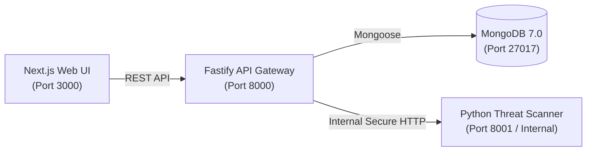

# SENTRIX

> **Don't trust the link. Verify the threat.**

SENTRIX is an intelligent website threat detection and trust intelligence platform that identifies phishing websites, malicious URLs, domain impersonation, TLS certificate weaknesses, and web security misconfigurations.

---

## Key Capabilities

- **Intelligent Phishing & Impersonation Detection:** Uncovers homoglyph/punycode attacks (`xn--`), brand typosquatting, credential harvesting forms, and suspicious lexical entropy.
- **TLS/SSL Cryptographic Auditing:** Extracts X.509 certificate chains, verifies hostnames, checks expiration dates, and identifies self-signed root authorities.
- **Web Security Misconfiguration Assessment:** Flags missing defensive headers (`HSTS`, `CSP`, `X-Frame-Options`, `X-Content-Type-Options`) and hidden exploit iframes.
- **Perimeter SSRF Defense:** Strictly enforces RFC 1918 private IP blocking, loopback defense, and cloud metadata protection (`169.254.169.254`, `metadata.google.internal`).
- **Explainable Risk Scoring:** Transparent 0–100 threat scoring engine mapping findings to `BENIGN`, `SUSPICIOUS`, and `MALICIOUS` classifications with associated MITRE ATT&CK tactics.
- **Collaborative Community Threat Intelligence:** Submit community reports, search global threat indexes, and vote on threat alerts.

---

## Technology Stack

| Layer | Technologies |
| :--- | :--- |
| **Frontend** | Next.js 14 (App Router), TypeScript, Tailwind CSS, Lucide Icons, Recharts, React Hook Form, Zod |
| **Backend** | Node.js, Fastify 5, TypeScript, Mongoose ODM, `@fastify/rate-limit`, `@fastify/cors` |
| **Scanner Engine** | Python 3.15, FastAPI, Pydantic v2, `httpx`, `BeautifulSoup4`, `cryptography`, `tldextract` |
| **Database** | MongoDB 7.0 with compound and unique indexes |
| **Infrastructure** | Docker, Docker Compose, Podman rootless compatibility |

---

## Monorepo Architecture



```
sentrix/
├── apps/
│   ├── web/              # Next.js frontend application
│   └── api/              # Fastify API gateway
├── services/
│   └── scanner/          # Python FastAPI threat analysis engine
├── packages/
│   └── shared/           # Shared TypeScript models, schemas, and utils
├── docs/
│   ├── ARCHITECTURE.md   # Architectural design and sequence diagrams
│   ├── API.md            # Comprehensive REST API reference
│   ├── THREAT-MODEL.md   # SSRF defense, adversary model, security policies
│   ├── DATABASE.md       # MongoDB collections, indexes, and schemas
│   └── DEVELOPMENT.md    # Local setup and workflow instructions
├── docker-compose.yml    # Multi-container orchestration
└── README.md
```

---

## Quick Start Guide

### 1. Prerequisites
- Node.js (v20+ or v22+) & `npm`
- Python 3.11+
- Docker or Podman

### 2. Environment Configuration
Create actual local `.env` files for each component (note: all `.env` files are in `.gitignore`):

**`apps/web/.env`**:
```bash
NEXT_PUBLIC_API_URL=http://localhost:8000
```

**`apps/api/.env`**:
```bash
PORT=8000
NODE_ENV=development
MONGODB_URI=mongodb://localhost:27017/sentrix
SCANNER_INTERNAL_URL=http://localhost:8001
SCANNER_API_SECRET=your_generated_64_char_hex_secret
CORS_ORIGIN=http://localhost:3000
```

**`services/scanner/.env`**:
```bash
PORT=8001
SCANNER_API_SECRET=your_generated_64_char_hex_secret
GOOGLE_SAFE_BROWSING_API_KEY=
URLHAUS_ENABLED=true
LLM_API_KEY=
```

### 3. Build & Run Locally

```bash
# 1. Install root & workspaces dependencies using npm
npm install
npm --workspace=@sentrix/shared run build

# 2. Setup Python Virtual Environment
cd services/scanner
python3 -m venv .venv
source .venv/bin/activate
pip install -r requirements.txt
cd ../..

# 3. Start MongoDB
docker run -d --name sentrix-mongo -p 27017:27017 mongo:7.0

# 4. Start Services (separate terminals or npm run scripts)
npm run dev:scanner   # Starts FastAPI on :8001
npm run dev:api       # Starts Fastify on :8000
npm run dev:web       # Starts Next.js on :3000
```

### 4. Or Run with Docker Compose

```bash
docker compose up --build
```

Access the web platform at `http://localhost:3000`.

---

## Verification & Test Suite

Run Python scanner test suite (SSRF, Analyzers, API Auth):
```bash
cd services/scanner
.venv/bin/pytest
```

Run TypeScript compilation checks:
```bash
npm --workspace=@sentrix/shared run build
npm --workspace=@sentrix/api run build
npm --workspace=@sentrix/web run build
# Or build all with one command:
npm run build
```

---

## Documentation

- [System Architecture](file:///home/tushardevx01/Documents/SENTRIX/docs/ARCHITECTURE.md)
- [API Reference](file:///home/tushardevx01/Documents/SENTRIX/docs/API.md)
- [Threat Model & SSRF Defense](file:///home/tushardevx01/Documents/SENTRIX/docs/THREAT-MODEL.md)
- [Database Schema & Indexes](file:///home/tushardevx01/Documents/SENTRIX/docs/DATABASE.md)
- [Development Guide](file:///home/tushardevx01/Documents/SENTRIX/docs/DEVELOPMENT.md)

---

## License

Private & Confidential — SENTRIX Security Intelligence Platform.
