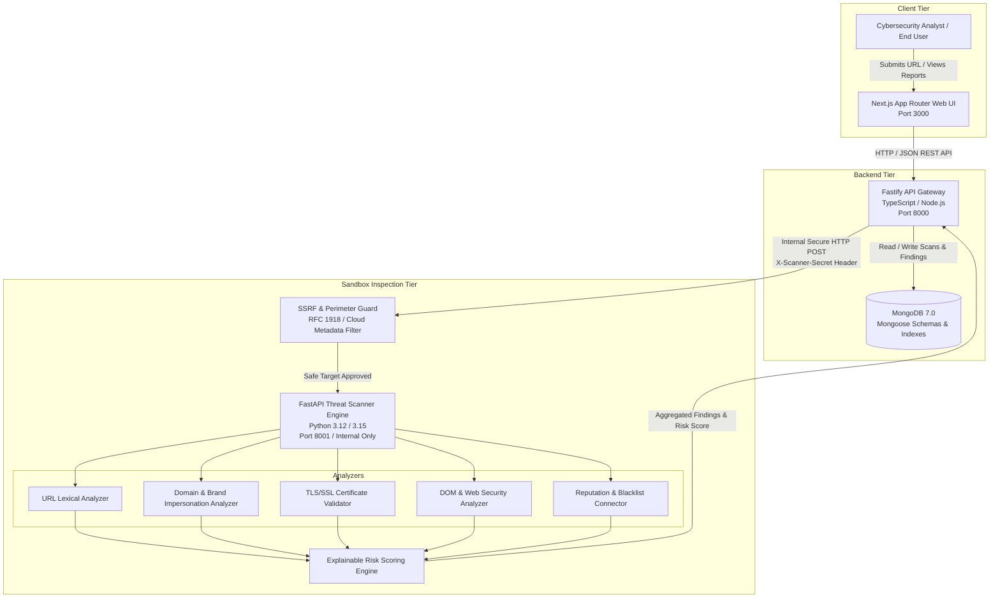

# SENTRIX System Architecture

> **Tagline:** Don't trust the link. Verify the threat.

SENTRIX is a modular, high-throughput website threat detection and trust intelligence platform engineered to identify credential phishing, domain impersonation, malicious redirects, TLS/SSL weaknesses, and web security misconfigurations.

---

## 1. High-Level Architecture Overview

The system is split into three decoupled tiers with strict boundary isolation:

---

## 2. Core Service Responsibilities

### 2.1 Next.js Frontend (`apps/web`)
- **Technology:** Next.js 14 (App Router), TypeScript, Tailwind CSS, Lucide Icons, Recharts.
- **Responsibilities:**
  - Zero-trust interactive threat submission console.
  - Interactive forensic security report visualizer with risk gauge and findings tree.
  - Real-time telemetry dashboard (genuine MongoDB data; no fabricated numbers).
  - Crowdsourced community threat reporting and upvote/downvote verification feed.
  - Security scan audit history with domain filtering.
- **Security Boundary:**
  - Accesses public endpoints only via `NEXT_PUBLIC_API_URL`.
  - Zero knowledge of database credentials or internal scanner secret.

### 2.2 Fastify API Backend (`apps/api`)
- **Technology:** Fastify 5, TypeScript, Mongoose ODM, Zod, `@fastify/rate-limit`, `@fastify/cors`.
- **Responsibilities:**
  - Input validation and URL normalization (prepends scheme, extracts host, cleans ports).
  - Persistence lifecycle for `Scan`, `Finding`, `Certificate`, `ThreatReport`, `ThreatVote`, and `User`.
  - Authorized delegation to internal Python scanner via HTTP with `X-Scanner-Secret`.
  - Rate limiting (120 req/min/IP), structured JSON logging, and centralized error handling.
  - Telemetry aggregation for the security dashboard.
- **Security Boundary:**
  - Sole service with direct MongoDB connection credentials.
  - Isolates database access away from both public users and the Python scanner.

### 2.3 Python Threat Scanner Service (`services/scanner`)
- **Technology:** FastAPI, Python 3.15, Pydantic v2, `httpx`, `BeautifulSoup4`, `cryptography`, `tldextract`.
- **Responsibilities:**
  - **Perimeter Defense (`ssrf_guard.py`):** Blocks loopback, private IPv4/IPv6 (RFC 1918), AWS/GCP/Azure link-local metadata (169.254.169.254), and disallowed URI schemes.
  - **URL Lexical Analyzer:** Detects raw IP destinations, punycode/IDN homoglyphs (`xn--`), embedded credentials (`@`), excessive length, and credential keywords.
  - **Domain Analyzer:** Categorizes TLD risk profiles, detects typosquatting and impersonation of major financial, tech, and e-commerce brands.
  - **TLS/SSL Analyzer:** Connects via SSL socket, extracts X.509 certificate fields, verifies hostname matching, calculates SHA-256 fingerprint, and identifies expired or self-signed certs.
  - **Web Security Analyzer:** Inspects missing HTTP security headers (HSTS, CSP, X-Frame-Options, X-Content-Type-Options) and parses DOM HTML for password forms submitting across external domains or unencrypted HTTP.
  - **Reputation Analyzer:** Connects to threat feeds (URLhaus, Google Safe Browsing) to check active malware/phishing listings.
  - **Risk Aggregation Engine:** Transparent weighted heuristic scoring (0–100) computing `BENIGN`, `SUSPICIOUS`, or `MALICIOUS` verdicts with explainable risk factors.
- **Security Boundary:**
  - Internal network only: never exposed publicly on the host.
  - Requires pre-shared key authentication via `X-Scanner-Secret`.
  - Stateless execution: strictly prohibited from accessing MongoDB directly.

---

## 3. End-to-End Scan Communication Sequence

```mermaid
sequenceDiagram
    autonumber
    actor User as User / Analyst
    participant Web as Next.js Web
    participant API as Fastify API
    participant DB as MongoDB
    participant Scanner as Python Scanner Engine

    User->>Web: Submits URL (e.g., https://paypal-verify.xyz/auth)
    Web->>API: POST /api/v1/scans { url, deepScan }
    API->>API: Normalize URL & validate syntax (Zod)
    API->>DB: Insert Scan record (status: IN_PROGRESS)
    API->>Scanner: POST /api/v1/analyze (Header: X-Scanner-Secret)
    
    rect rgb(20, 25, 45)
        Note over Scanner: Perimeter Validation
        Scanner->>Scanner: SSRF Guard: Validate domain and resolved IPs
        alt IP is Private or Metadata Service
            Scanner-->>API: 400 Bad Request (SSRF_VIOLATION)
            API->>DB: Update Scan (status: FAILED, error: SSRF_VIOLATION)
            API-->>Web: 400 Bad Request with security explanation
        end
        Note over Scanner: Heuristic Analysis Pipeline
        Scanner->>Scanner: Run UrlAnalyzer, DomainAnalyzer, TlsAnalyzer, WebSecurityAnalyzer, ReputationAnalyzer
        Scanner->>Scanner: RiskAggregationEngine.evaluate()
    end

    Scanner-->>API: 200 OK (AnalysisResponse)
    API->>DB: Bulk insert Findings
    API->>DB: Upsert Certificate details
    API->>DB: Update Scan (status: COMPLETED, riskScore, verdict, completedAt)
    API-->>Web: 201 Created (Scan metadata & initial verdict)
    Web->>API: GET /api/v1/reports/:id
    API->>DB: Query Scan, Findings, and Certificate
    DB-->>API: Document details
    API-->>Web: 200 OK (Full Forensic Report)
    Web-->>User: Render Forensic Visualizer (Score Gauge, Evidence Tree, TLS Card)
```

---

## 4. Architectural Decisions Record (ADR)

1. **MongoDB Exclusivity:** Standardizes storage on document collections for polymorphic security finding evidence without requiring rigid relational schema migrations.
2. **Stateless Scanner Isolation:** Keeping the Python scanner completely stateless and decoupled from the database allows horizontal autoscaling of scanning workers and prevents compromised scanner sandboxes from accessing the datastore.
3. **Internal Pre-Shared Authentication:** Protects the analysis endpoint against unauthorized internal invocation via cryptographically secure secrets.
4. **Perimeter-First SSRF Defense:** Enforces socket address resolution and strict private IP filtering before any outbound HTTP probe or socket connection is established.
