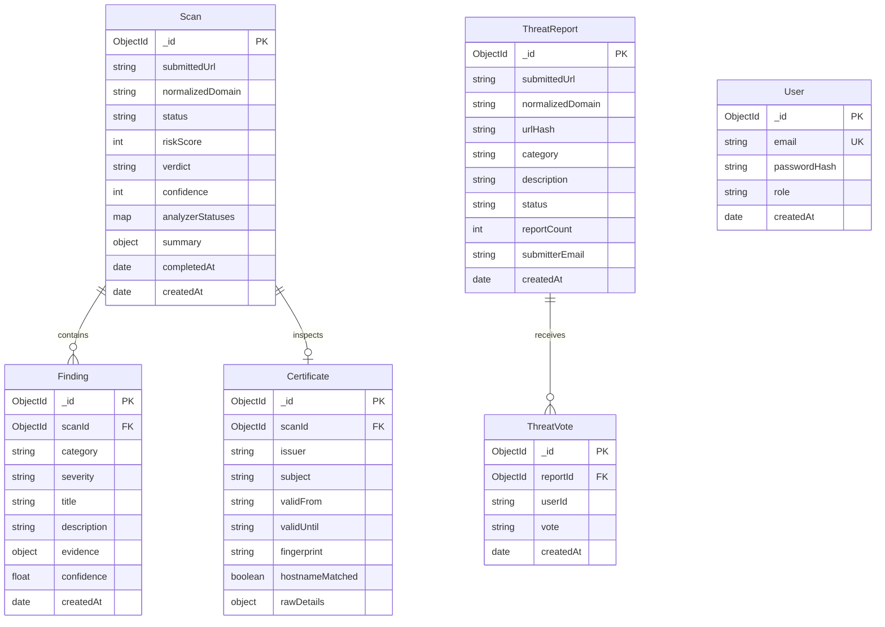

# SENTRIX Database Architecture & Data Schema

SENTRIX exclusively uses **MongoDB** as its primary persistent database, accessed strictly via **Mongoose ODM** within the Fastify backend service. The Python threat scanner has zero direct access to MongoDB.

---

## 1. Entity Relationship Overview

---

## 2. Collections Specification & Indexes

### 2.1 `scans`
Stores top-level scan lifecycle status, normalized destination metadata, and aggregated risk scoring.
- **Indexes:**
  - `{ normalizedDomain: 1, createdAt: -1 }`: Optimizes search and historical queries per domain.
  - `{ status: 1 }`: Accelerated queries for pending, in-progress, and failed jobs.
  - `{ verdict: 1 }`: Speeds up threat feed and dashboard filtering (`MALICIOUS`, `SUSPICIOUS`, `BENIGN`).
  - `{ createdAt: -1 }`: Default timeline sort.

### 2.2 `findings`
Stores polymorphic forensic evidence and individual threat indicators identified across security analyzers.
- **Indexes:**
  - `{ scanId: 1, severity: 1 }`: Rapid retrieval of findings for a specific report sorted by criticalness.
  - `{ category: 1 }`: Aggregation index for telemetry charts.

### 2.3 `certificates`
Stores X.509 TLS/SSL certificate chains, cryptographic fingerprints, and validity dates.
- **Indexes:**
  - `{ scanId: 1 }` (Unique): 1-to-1 relationship with the scan.
  - `{ fingerprint: 1 }`: Cross-scan search by SHA-256 certificate thumbprint.

### 2.4 `threatreports`
Stores crowdsourced threat submissions with de-duplication based on SHA-256 URL hash.
- **Indexes:**
  - `{ urlHash: 1 }`: Instant lookup to increment `reportCount` for duplicate submissions.
  - `{ normalizedDomain: 1 }`: Domain-level community threat checks.
  - `{ status: 1 }`: Filter by review state (`SUBMITTED`, `UNDER_REVIEW`, `CONFIRMED`, `DISMISSED`).
  - `{ createdAt: -1 }`: Feed pagination.

### 2.5 `threatvotes`
Stores upvotes and downvotes on community threat reports.
- **Indexes:**
  - `{ reportId: 1, userId: 1 }` (Unique Compound Index): Enforces single vote per user or session per threat report.

### 2.6 `users`
User identities and roles (`user`, `analyst`, `admin`).
- **Indexes:**
  - `{ email: 1 }` (Unique): Identity constraint.

---

## 3. Data Retention & Archival Strategy

- Completed scans and findings are retained indefinitely for historical auditing.
- Scans stuck in `PENDING` or `IN_PROGRESS` for longer than 15 minutes are transitioned to `FAILED` by background cleanup.
- Optional MongoDB TTL indexes can be configured on temporary raw evidence logs after 90 days.
