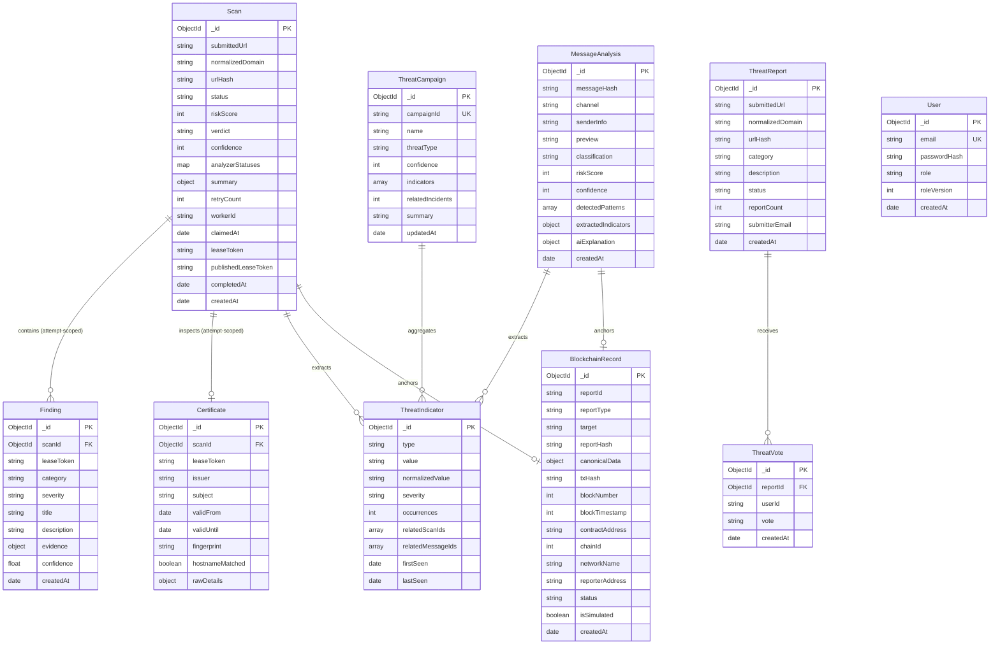

# SENTRIX Database Architecture & Data Schema

SENTRIX exclusively uses **MongoDB 7.0** as its primary persistent database, accessed strictly via **Mongoose ODM** within the Fastify backend service (`apps/api`). The Python threat scanner (`services/scanner`) has zero direct access to MongoDB.

In production, automatic index synchronization (`autoIndex` and startup `syncIndexes()`) is explicitly disabled (`autoIndex: false`) to eliminate blocking startup table locks and unpredictable schema churn. All 33 production indexes are managed explicitly via `IndexMigrationManager` with distributed locking in `_schema_migrations`.

---

## 1. Entity Relationship Overview



---

## 2. Collections Specification & Verified Indexes (33 Total)

All database indexes are strictly verified and managed by `IndexMigrationManager` (`apps/api/src/migrations/indexMigration.ts`).

### 2.1 `scans` (9 Indexes)
Stores top-level scan lifecycle status, normalized destination metadata, lease fencing tokens, and aggregated risk scoring.
- `{ status: 1, createdAt: 1 }`: FIFO queue polling index for atomic claiming by background workers.
- `{ status: 1, claimedAt: 1 }`: Accelerated index for abandoned job recovery reaper (timeout > 60s).
- `{ urlHash: 1, status: 1 }`: Deduplication index to check if identical URL is currently in flight.
- `{ urlHash: 1 }`: Partial unique index where `status IN ['QUEUED', 'PROCESSING']` preventing race-condition duplicate scans.
- `{ publishedLeaseToken: 1 }`: Lookup index for published results corresponding to winning worker attempt.
- `{ leaseToken: 1 }`: Lookup index for active worker attempt.
- `{ normalizedDomain: 1, createdAt: -1 }`: Optimizes search and historical queries per domain.
- `{ createdAt: -1 }`: Timeline sorting.
- `{ verdict: 1 }`: Dashboard and threat feed filtering.

### 2.2 `findings` (4 Indexes)
Stores polymorphic forensic evidence, security warnings, and individual threat indicators identified across security analyzers.
- `{ scanId: 1, severity: 1 }`: Rapid retrieval of findings for a specific report sorted by severity.
- `{ scanId: 1, leaseToken: 1 }`: Attempt-scoped pre-write cleanup and atomic rollback.
- `{ leaseToken: 1 }`: Orphan cleanup sweep index.
- `{ category: 1 }`: Threat telemetry aggregations.

### 2.3 `certificates` (4 Indexes)
Stores X.509 TLS/SSL certificate chains, cryptographic fingerprints, and validity dates.
- `{ scanId: 1 }`: Association index linking certificate to scan report.
- `{ scanId: 1, leaseToken: 1 }`: Compound unique sparse index per worker attempt.
- `{ fingerprint: 1 }`: Cross-scan correlation index by SHA-256 certificate thumbprint.
- `{ leaseToken: 1 }`: Attempt-scoped orphan cleanup index.

### 2.4 `messageanalyses` (3 Indexes)
Stores AI-analyzed scam messages across SMS, WhatsApp, Email, Telegram, and Social Media (Module A).
- `{ messageHash: 1 }`: SHA-256 hash lookup index for deduplication.
- `{ createdAt: -1 }`: Feed timeline sorting.
- `{ classification: 1, createdAt: -1 }`: Filter by verdict (`MALICIOUS`, `SUSPICIOUS`, `BENIGN`).

### 2.5 `threatindicators` (3 Indexes)
Stores atomic threat indicators (`DOMAIN`, `IP`, `WALLET`, `EMAIL`, `PHONE`) extracted across all scans and messages (Module B).
- `{ type: 1, normalizedValue: 1 }`: Unique compound index ensuring atomic indicator deduplication.
- `{ occurrences: -1 }`: Index to query top recurring threat indicators.
- `{ lastSeen: -1 }`: Query recent indicator activity.

### 2.6 `threatcampaigns` (2 Indexes)
Stores clustered cyber threat campaigns correlating recurring threat patterns (Module B).
- `{ campaignId: 1 }`: Unique campaign identifier constraint.
- `{ updatedAt: -1 }`: Query recently active attack campaigns.

### 2.7 `blockchainrecords` (4 Indexes)
Stores decentralized threat intelligence commitments committed to EVM smart contracts (`ThreatRegistry.sol`) or the simulated local ledger (Module C).
- `{ reportId: 1 }`: Lookup record by source report ID.
- `{ reportHash: 1 }`: Unique index on canonical SHA-256 report hash commitment.
- `{ txHash: 1 }`: Unique index on on-chain transaction hash or simulated commitment reference.
- `{ createdAt: -1 }`: Ledger explorer timeline sort.

### 2.8 `threatreports` (2 Indexes)
Stores crowdsourced threat submissions with de-duplication based on SHA-256 URL hash.
- `{ urlHash: 1 }`: Instant lookup to increment `reportCount` for duplicate submissions.
- `{ status: 1 }`: Filter by review state (`SUBMITTED`, `UNDER_REVIEW`, `CONFIRMED`, `DISMISSED`).

### 2.9 `threatvotes` (1 Index)
Stores upvotes and downvotes on community threat reports.
- `{ reportId: 1, userId: 1 }`: Unique compound index enforcing exactly 1 vote per user/IP per threat report.

### 2.10 `users` (1 Index)
User identities and roles (`user`, `analyst`, `admin`).
- `{ email: 1 }`: Unique identity constraint.

---

## 3. Migration & Operational Management

Index migrations are executed using the controlled CLI tool:

```bash
# Dry run: audit existing indexes and detect conflicts without modifying database
npm run migrate:indexes:dry-run

# Apply migrations: creates compound/unique indexes under distributed lock in _schema_migrations
npm run migrate:indexes
```

### Safety Guarantees
1. **Zero Table Locks on Startup:** Application boots instantaneously without invoking `syncIndexes()`.
2. **Atomic Distributed Lock:** Concurrency lock in `_schema_migrations` prevents multi-container race conditions.
3. **Data Deduplication Pre-Flight:** Validates that unique constraints will not fail due to preexisting duplicate records.
4. **Immutable `_id_` Protection:** Obsolete index pruning explicitly protects standard primary keys from accidental dropping.
